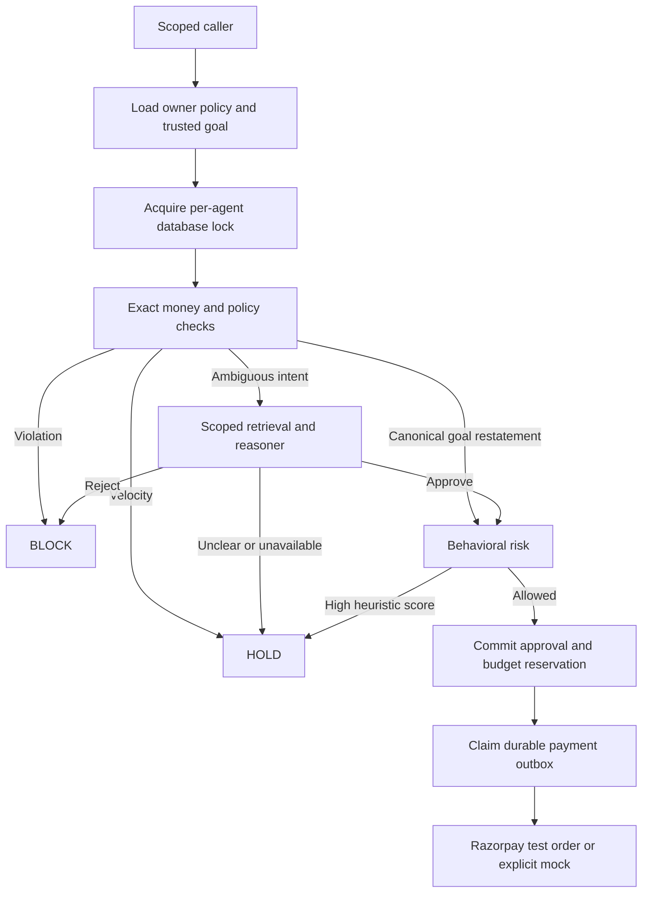

# Sentinel — Agent Payment Trust Layer

Sentinel evaluates proposed agent purchases against an owner-configured policy, records its decision, and produces **APPROVE**, **HOLD**, or **BLOCK**. It is a test-payment research/demo application, not a production banking service.

## Decision flow



Hard restrictions use deterministic comparisons. An exact normalized restatement of the authorized goal is a fast path; added purpose or changed wording requires semantic review. Explicit override patterns block before calling a model. Missing live-model credentials use conservative, clearly labeled mock reasoning, never fabricated live results.

## Main guarantees and boundaries

- Separate admin, owner, reviewer, and agent credentials with agent/owner scopes.
- Server-owned goals and processing time for submitted live API requests. Agents cannot edit policies or resolve holds.
- HttpOnly, revocable browser sessions; credentials are not bundled into frontend assets.
- A PostgreSQL advisory transaction lock serializes policy updates, evaluations, and review per agent, including first policy creation.
- Exact integer-paise comparisons and numeric persisted amounts. Full-ledger SQL budget totals and velocity counts are independent of the bounded behavioral history.
- Every approval commits a reservation and a payment outbox entry before external IO.
- Atomic payment claims, stable request replay, and refusal to blindly retry unknown gateway outcomes.
- Only an unresolved HOLD can be reviewed, once, with current hard-policy and allowance checks. Original verdict and reviewer event remain separate.
- Payment reservations, created orders, mock orders, unknown outcomes, and captured payments are distinct. Created or unknown orders keep allowance reserved; order creation is not settlement.
- Redis Streams support pending-entry recovery and lease renewal. Delivery is **at least once**, not exactly once; database idempotency and outbox claims protect side effects.
- Distributed quotas use Redis server time and an atomic sliding-window script. Redis mode never silently falls back to a private process queue.
- AP2-shaped unsigned JSON cannot authorize payments: the HTTP adapter returns 501 until authenticated protocol support is implemented.
- Live Razorpay keys are rejected. Only `rzp_test_` keys or explicit local mocks are supported.

## Start the local demo

Prerequisites: Docker/Compose, Python 3.12, and Node 22 for frontend development.

```bash
python3 scripts/setup_dev.py
docker compose up -d --build
docker compose exec backend1 python -m app.demo.reset_and_seed --confirm-reset
```

Open **http://localhost:8000**. Sign in using the generated local-admin credential stored in `backend/.env`. Keep that file private. The setup script refuses to overwrite existing environment files.

The seed resets demo data and produces 18 transactions: 6 APPROVE, 2 HOLD, and 10 BLOCK. Reset is disabled in the production profile. Never run it against valuable data.

Compose runs PostgreSQL, persistent Redis with AOF, migrations, two non-root backend replicas, the built frontend, and a loopback-bound nginx gateway. Database and Redis ports are not published. Backend containers have no development reload or source bind mount.

For frontend development:

```bash
cd frontend
npm ci
npm run dev
```

Vite proxies `/api` to the local backend. Never put an API key in `VITE_` variables. Only non-secret frontend configuration belongs there.

## Access configuration

`SENTINEL_CREDENTIALS` is a server-side JSON array. Every entry needs a unique 32+ character key, unique subject, and role:

| Role | Scope and permissions |
|---|---|
| `admin` | Administration, evaluations, review, metrics, reconciliation |
| `owner` | `owner_id`; manage own policies and submit/review own agents |
| `reviewer` | `owner_id`; read and review that owner's agents |
| `agent` | `agent_ids`; submit/read permitted agents; cannot manage policies or review |

Browser login exchanges a human credential for an eight-hour HttpOnly session. Cookie mutations require an allowlisted Origin and `X-Sentinel-CSRF: 1`. Rotating/removing the credential revokes its sessions. Service callers use `X-API-Key`.

The development fallback key is allowed only without scoped credentials and outside the production profile. The production profile requires PostgreSQL, Redis queue/quota backends, scoped credentials, explicit HTTPS origins, a configured live reasoning provider, and Razorpay **test** credentials. TLS must be terminated by your deployment infrastructure; the included gateway is a local HTTP demo.

## API overview

| Area | Routes |
|---|---|
| Session | `POST /auth/login`, `GET /auth/me`, `POST /auth/logout` |
| Policies | `POST /policies`, `GET /policies`, `GET /policies/{agent_id}` |
| Transactions | `POST /transactions/evaluate`, `POST /transactions/evaluate-batch`, feed/search/pagination/summary/scenarios |
| Background work | `GET /jobs`, `GET /jobs/{job_id}`, `GET /jobs/batch/{batch_id}` |
| Simulations | `POST /simulate`, `POST /simulate-async` (disabled in production profile) |
| Review | `POST /holds/{request_id}/resolve` |
| Provider | Signed `POST /payments/webhook`; admin reconciliation endpoints |
| Evidence | `GET /eval/report`, scoped `GET /feedback/cases`, admin `GET /metrics` |
| Health | `GET /health` |

With Compose, prefix API routes with `/api`. Reconciliation requires a known provider order ID; Sentinel fetches it and verifies request correlation, INR currency, and exact amount before updating state. Unknown outcomes remain reserved until reconciled. Captured-state webhooks require a valid HMAC signature and are deduplicated.

## Test and evaluate

```bash
python3 -m venv .venv
.venv/bin/python -m pip install -r backend/requirements-dev.txt
REDIS_URL=redis://localhost:6379/0 .venv/bin/python -m pytest backend/tests -q --timeout=45
cd frontend
npm ci
npm test
npm run lint
npm run build
```

Tests default to a disposable SQLite database. Set `SENTINEL_TEST_DATABASE_URL` to a dedicated PostgreSQL database whose name ends in `_test` to exercise cross-connection PostgreSQL locking. Tests never use the application's configured database or provider keys. Redis tests use isolated namespaces.

The GitHub workflow provisions PostgreSQL/Redis services and verifies both fresh and legacy schema migrations. The [recorded successful run](https://github.com/TheMS1314/sentinel/actions/runs/43938151453) passed **147 backend tests** and **4 frontend tests**, frontend lint/build and npm audit. See [verification status](docs/HARDENING_REPORT.md) for the execution scope and remaining external integration limits.

```bash
PYTHONPATH=backend .venv/bin/python -m app.eval.eval_harness
PYTHONPATH=backend .venv/bin/python -m app.eval.eval_harness backend/data/hard_dataset.json
PYTHONPATH=backend .venv/bin/python -m app.eval.eval_harness backend/data/prevalence_dataset.json
PYTHONPATH=backend .venv/bin/python -m app.fuzz.run
PYTHONPATH=backend .venv/bin/python -m app.loadtest.run --requests 100 --workers 4 --agents 10
```

Evaluation, fuzzing, and the pipeline benchmark run in separate processes against disposable databases and mock payment gateways. Model runtime/mode and dataset fingerprint are recorded. To require an actual model, configure its key/model and set `SENTINEL_EVAL_REQUIRE_LIVE=1`. To compare retrieval, repeat the same evaluation with `SENTINEL_DISABLE_RETRIEVAL=1` and archive both outputs. The project does not claim retrieval benefit without such evidence.

Current refreshed offline reports: golden **89/89**, synthetic prevalence **500/500**, hard **14/16** with conservative mock reasoning, fuzz **187 cases / zero selected invariant violations**. The two hard-set misses are conservative holds where constructed labels expected approval. These are not real-world fraud-detection rates or live-model quality measurements.

Behavioral weights and the distribution-monitor threshold remain uncalibrated heuristics. Monitor alerts never change authorization. Feedback export marks cases for history/label review; it does not automatically retrain or expand authority.

## Risk intelligence extension

The administrator dashboard now includes **Risk intelligence**: expiring local threat indicators, owner-scoped merchant cyber-risk profiles, descriptive multi-agent merchant correlation, and a separate emergency dispatch guard with a freeze and exact rolling count/amount limits. Intelligence can restrict a decision; it cannot expand owner policy authority. Current confirmed threats are checked again before dispatch.

Mastercard Decision Intelligence, Recorded Future and RiskRecon are **not connected**. Local records are labeled operator or synthetic evidence; unknown identity and absent local matches are not safe ratings. The dispatch guard runs inside Sentinel, not on a payment network. See the [design, controls, API and integration path](docs/RISK_INTELLIGENCE.md).

Run migrations before using these controls on an existing database. Paused payments retain their reservations and can resume automatically after controls allow dispatch; review pending work before unfreezing.

## Existing installations

Back up the database, then run Alembic migrations using the configured backend database:

```bash
docker compose run --rm db-init
```

Migration preserves transaction and decision history, adds provenance/review/payment/session records, conservatively reserves historical approvals as unknown, and disables legacy policies without an explicitly configured authorized goal. Owners must re-save those policies. Duplicate historical version numbers require explicit operator resolution; migration refuses to guess. Existing model/provider results are historical evidence, not automatically reverified results.

## Limits

Merchant names/categories remain caller assertions; this project does not establish verified merchant identity or implement real customer charging. AP2 cryptographic verification is unsupported and cannot authorize an order. Provider test credentials and live LLM keys are needed to verify those external integrations. Database administrators remain trusted; these records are not a cryptographically immutable audit system. Redis AOF `everysec` can lose recent writes on a host crash, and shared dependencies remain single points of failure in this local topology.

More detail: [architecture](docs/ARCHITECTURE.md), [gap-by-gap changes and verification](docs/HARDENING_REPORT.md).
