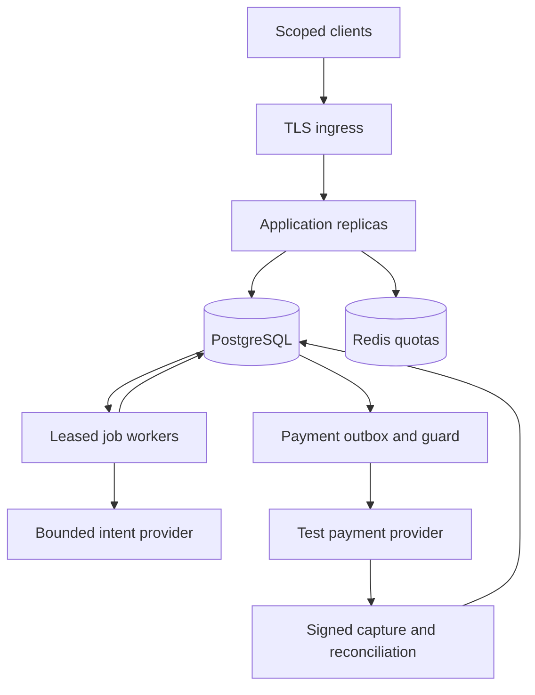

# Production engineering and release boundaries

Sentinel is a modular agent-payment control service. Its money connector still accepts only Razorpay test keys. This document describes the implemented runtime, its measured checks, and deployment work that must be verified before a production launch. Passing a test suite does not validate a financial provider contract, merchant identity, or disaster recovery across a real provider.

## Runtime design

PostgreSQL is the source of truth for accepted jobs, policies, decisions, reservations, dispatch claims, sessions and audit events. Redis is a shared quota dependency, not a second authority for accepted work. Two stateless application replicas can serve the same database. Each replica currently contains bounded evaluation and recovery workers; the architecture intentionally keeps one application deployment unit until profiling justifies separating workers.



The included Compose stack has a single host, gateway, PostgreSQL node and Redis node. It is a reproducible acceptance topology, not a multi-zone HA deployment. A production deployment needs a redundant TLS ingress and a managed/failover-capable PostgreSQL service with tested backups and an agreed RPO/RTO. Redis failure deliberately stops new API work through the quota check; it does not erase already accepted jobs.

## Resolved runtime blockers

| Finding | Implemented boundary |
|---|---|
| Model IO held an agent lock and connection | Prepare under a short transaction, call outside it, then reacquire and recheck current policy, clock and allowance; discard stale policy reasoning |
| Redis acceptance could outlive its persistence | Atomically accept complete batches in PostgreSQL, with a shared capacity bound and no fallback |
| Worker lease could expire while work continued | Unique lease tokens fence both final authorization and job completion; PostgreSQL row locks prevent takeover during a commit |
| Long outages could execute stale commands | Never-started jobs expire after five minutes by default; exhausted recovery attempts become visible terminal failures |
| Crashed provider calls stayed processing | Stale processing becomes unknown and remains reserved for reconciliation, never an automatic second order |
| Late gateway response could undo capture | Finalization reloads under row lock and preserves captured/already reconciled outcomes |
| Old pending approvals could resume indefinitely | Five-minute default dispatch deadline, explicit pending-only cancellation, policy/credential recheck and current threat checks |
| Infrastructure outage could block emergency freeze | Privileged DB-backed freeze command independent of Redis and HTTP ingress |
| Pool/lock waits could consume all capacity | Bounded connection pool, acquisition/connection/statement/lock/idle transaction timeouts and retryable 503 responses |
| Synchronous dependencies blocked the HTTP loop | DB authentication runs in sync dependencies; batch preparation and webhook persistence run in worker threads |
| Model and gateway transports accumulated resources | Lazy bounded model clients, explicit timeout/retry budgets and transport close; no gateway order retries after uncertainty |
| Large/slow bodies and overload were unbounded | Streaming-aware body limit, total body-read deadline, per-process admission and server connection limits |
| Job ownership could change after submission | Recheck current agent scope when reading jobs; recheck submitting subject before processing |
| Replica recreation could leave stale gateway DNS | Docker resolver with shared upstream zones and bounded failover; accepted requests carry stable IDs |
| Historical migrations depended on future ORM schema | Frozen revision-specific schema snapshots; explicit later migration owns new runtime fields/tables |

## Money and command lifetimes

An HTTP 200 approval is a recorded authorization decision, not proof of capture. A submitted service request must carry a stable `request_id` in the production profile. Retrying that ID with identical facts returns its durable decision; changing its facts conflicts.

An approval reserves allowance and commits a pending payment intent. Dispatch checks its deadline, current policy identity, current authorizing credential scope, emergency limits and confirmed threats before atomically claiming it. Human review binds its new authorization to the policy used at review. A policy change or revoked actor can pause a previously approved intent.

Pending reservations can expire or be cancelled because no provider claim has been made. Processing, created and unknown outcomes cannot be released by that cancellation endpoint. Only verified capture counts as completed spending. A process can crash immediately before or after external IO; the database cannot prove which happened. Unknown states require provider reconciliation. Stable receipt correlation is not a substitute for a contractual provider idempotency guarantee.

The outbox checks up to eight pending rows per cycle, with at most four parallel provider calls and separate sessions. Paused attempts move to the back of recovery order. Freeze prevents new claims; a previously claimed external call can still finish. Expiry uses the authorization deadline rather than the last recovery timestamp.

## Queue contract

Production requires `QUEUE_BACKEND=postgres`. Admission serializes only its short capacity check and insert transaction. Capacity is 500 outstanding jobs by default in the queue constructor. A batch is accepted in full or rejected with 503/Retry-After; partial admission is not a success.

Workers use `FOR UPDATE SKIP LOCKED` so they can claim different rows. A claim has a 60-second renewable lease and an opaque token. Old tokens cannot authorize or overwrite a winner's result. Dependency errors retry the same durable request, with a five-attempt processing budget. Other failures are visible FAILED results. Failed jobs are not evidence that no payment effect exists: inspect the original request/ledger before choosing a new ID.

Never-started work older than `SENTINEL_JOB_MAX_AGE_SECONDS` fails before authorization. Completed jobs remain for 24 hours by default; cleanup keeps incomplete batches intact and removes eligible complete batches as a whole. Ledger history is not deleted with job retention. Delivery is at least once, not exactly once.

Memory and Redis Stream queues remain compatibility/development implementations. They are rejected by the production profile. Before upgrading an existing Redis installation, stop new submissions, drain old workers, inspect unresolved payment effects, verify the old stream is empty, and then switch. New startup refuses an outstanding hardened-v2 Redis stream rather than silently abandoning it. Do not deploy two different queue backends against an active workload.

## Capacity and overload

Defaults are deployment inputs, not a universal sizing claim:

| Limit | Default |
|---|---:|
| PostgreSQL connections per replica | 10, no overflow |
| Pool acquisition / connection timeout | 3s / 3s |
| SQL statement / lock / idle transaction timeout | 10s / 2s / 15s |
| Application HTTP admission / server concurrency | 32 / 64 per replica |
| Request body / total body-read time | 512 KiB / 10s |
| Signed webhook body | 64 KiB |
| Live model concurrency | 4 per replica |
| Model timeout / attempts | 10s per SDK operation / 2 attempts |
| Gateway connect / read timeout | 3.05s / 10s, no automatic order retry |
| Evaluation workers | 4 per replica |
| New job / pending approval lifetime | 300s / 300s |
| Stale dispatch detection | 120s |
| Background shutdown drain / container grace | 30s / 45s |

SDK read timeouts are transport-operation limits, not a proof of a strict wall-clock provider deadline. If an in-flight thread cannot be interrupted, lease fencing and durable request IDs protect effects. Redis client pools are reused and bounded. Numeric-library CPU threading is limited inside the backend image.

Two default replicas budget 20 PostgreSQL application connections, plus migrations/operations and any other clients. Raise concurrency only after measuring database wait, model latency, queue age, gateway latency and memory. The global dispatch guard deliberately serializes a small database-only claim section; it never holds that lock across provider IO. Sharding away that lock would change aggregate-limit semantics and requires an explicit design.

## Deployment configuration

Use the checked-in `.env.example` as a reference; generate development secrets with `scripts/setup_dev.py`. Inject actual deployment secrets through the platform's secret manager. Neither example files nor container logs should contain real credentials.

The production profile additionally requires scoped credentials, explicit HTTPS allowed origins, explicit allowed hosts, a chosen live model/provider, a 32+ character webhook secret, Razorpay test credentials, the SQL queue, Redis quotas and current schema revision. It disables simulations and development shared-key fallback. Configure proxy trust to actual ingress addresses/CIDRs; wildcard trust is disabled by the server launcher. The Compose subnet can be changed with `SENTINEL_SUBNET` if it overlaps an existing network.

Use private, authenticated, encrypted database/cache endpoints appropriate to the deployment. The included local PostgreSQL/Redis services do not provision that infrastructure. Use separate environments and separate quota/database namespaces/endpoints for staging and production. Keep database application permissions separate from migration/backup administration in a real deployment; the local bootstrap role is intentionally convenient and is not a least-privilege production database role.

Credentials are currently an operator-configured scoped registry, not a customer identity platform. Deploy its configuration consistently to every replica; revocation is checked against each replica's current registry. Public/customer authentication, MFA/SSO, coordinated secret rotation and a shared identity authority need a deployment-specific integration and verification. They are not silently provided by environment variables.

## Upgrade and rollback

1. Enter a maintenance window or prevent new submissions. Drain legacy queue work before changing backends. Capture a verified database backup.
2. Run the one-shot migration job before starting new application replicas: `docker compose run --rm db-init`.
3. Revision `0003_runtime_safety` adds durable jobs, submitting actor and dispatch validity/binding fields plus operational indexes. Old pending intents without a validity contract expire rather than receiving new authority. Existing created/unknown/captured records remain for reconciliation.
4. Start the new replicas, check readiness through ingress, verify policy/owner scopes and replay behavior, then admit traffic gradually.
5. Roll back application code only with a reviewed compatibility plan. Destructive database downgrades are disabled. Never replace the financial ledger with an older backup while allowing payment dispatch.

## Incident operations

`GET /health/live` is a cheap process check. `GET /health/ready` and `/health` check database/queue, worker tasks, Redis quota access and outbox progress. Readiness failure removes traffic; liveness should not cause a restart loop just because PostgreSQL or Redis is unavailable. Compose exposes API probes under `/api`, and ingress `/health` forwards to readiness.

`GET /metrics` is administrator-only and reports ledger states, queue backlog and review backlog. Alert delivery/export is not provisioned by this repository. Connect monitoring to readiness, sustained 503/429 rates, oldest queued/processing age, failed jobs, unknown payment count, repeated outbox errors, database connection waits, disk/WAL growth and quota memory saturation. Access logs have bounded request IDs, status and duration and omit bodies/credentials; database statement parameters are hidden.

For an emergency freeze when HTTP or Redis is unavailable:

```bash
docker compose exec backend1 python -m app.ops.freeze --reason "Incident investigation"
```

This command requires privileged deployment-shell/database access and records an operator audit event. It can only freeze. Review pending payments in the administrator dashboard; cancel undesired undispatched reservations with a reason. Resume using the versioned guard only after resolving the incident. Unknown/processing effects require provider reconciliation, not cancellation.

Backups must include policies, jobs, ledger/decision records, dispatch claims and audit events as a consistent database snapshot. Encrypt them, protect access separately, and verify restoration into an isolated database regularly. After disaster recovery, keep dispatch frozen until restored history is reconciled with provider effects. A database restore cannot roll back an external payment, and an asynchronous failover can lose acknowledged history unless the infrastructure contract prevents it. The CI restore exercise proves the local logical-backup path, not a production RPO/RTO or provider recovery plan.

## Evidence and release gates

The GitHub `containers` job builds the real images and runs `scripts/container_acceptance.py` only against a fresh `sentinel-ci-*` project. It checks HTTP replay/hard caps/concurrency, freeze/cancel, accepted job survival through Redis interruption, fail-closed quotas/readiness, a stopped/recreated backend, dynamic DNS and logical backup restoration. It writes timings, success/failure counts and image identifiers to its artifact. These are mock-provider smoke measurements, not production capacity or fraud-quality claims.

The completed runtime run passed **202 backend tests**, **nine frontend tests**, runtime audits and **all 23 container checks**, including PostgreSQL/Redis interruptions and recovery: [run 44044494272](https://github.com/TheMS1314/sentinel/actions/runs/44044494272). Machine-readable measurements and scope are in [verification evidence](verification/production-ci.json); HARDENING_REPORT.md records the full outcome.

A production launch still requires real model/test-provider contract tests, trusted merchant identity, representative labeled evaluation/calibration, environment-specific identity and secret operations, multi-zone database/ingress failover, external TLS, monitored alert delivery, and a measured backup/restore/provider reconciliation drill. Real-money support remains deliberately disabled until those contracts are established.
